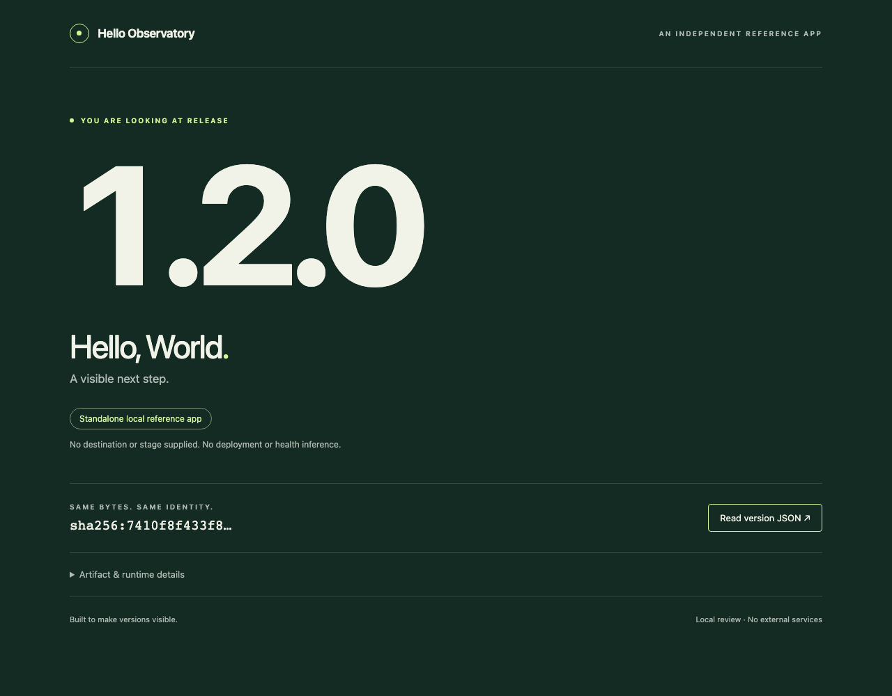

# AO-INC-003A — Standalone reference evidence

Clean implementation source: [`a692f78dde502c00fbf7ec6b6f126476d0322ea5`](https://github.com/bobrs/observatory-hello-reference/commit/a692f78dde502c00fbf7ec6b6f126476d0322ea5). Baseline main is the docs/license-only `e8efdc5914df8188ba46033dcee8c743c10f9c9b`. This evidence is committed separately; the PR records verification at its final head. Source, artifact identity and runtime context remain different facts.

## Actual checks

Environment: Node **24.22.1**, npm **11.13.0**, macOS arm64; development-only Playwright **1.64.1** / Chromium **156.0.8078.4**. Runtime packages: **none**. Node/browser were installed in this project's ignored local caches; no global runtime/host configuration was changed.

```sh
npm ci --no-fund
npm run verify
PLAYWRIGHT_BROWSERS_PATH=.cache/playwright npx playwright install chromium
npm run demo
git diff --check
git status --porcelain=v1
```

- Lockfile installation passed; npm reported 0 known package vulnerabilities (not a security assessment).
- Syntax checks passed; **8 native tests passed, 0 failed/skipped**. Coverage includes two independent builds, explicit byte membership/canonical identity, missing/extra/linked files, external expected digest required before execution, self-consistent tampering rejected by the old external digest, output/index link refusal, actual HTTP page/JSON agreement for all three releases, read-only/no-store/loopback behavior, escaped context, version-override resistance, context/boot independence and restart of the exact retained earlier package.
- The app continues serving its verified startup snapshot after the on-disk page is changed in a disposable test; the external verifier rejects those changed disk bytes. This is not a hostile same-user isolation guarantee.
- Standalone browser checks passed for **1.0.0 / 1.1.0 / 1.2.0** at 1280×1000 and for 1.2.0 at 390×844, including version/JSON agreement, details disclosure, no mobile overflow, no page/console/HTTP errors and no external requests. Screenshots were visually inspected.
- A one-off standalone Production-context check displayed **DISPOSABLE DEMO — NOT REAL PRODUCTION**, with the same 1.2.0 artifact ID. An unmarked Production context was refused. This creates no managed destination or Step B workflow.
- Checkout was clean during captured runs. [report.json](report.json) preserves exact source, dirty flag, capture time and observed identities; [artifact-index.json](artifact-index.json) records expected package identities outside the packages. [SHA256SUMS](SHA256SUMS) identifies these two reports and five screenshots. Final recorded test/demo processes were closed and temporary package directories removed.

## Reproducible artifact IDs

| Baked release | Package identity |
| --- | --- |
| 1.0.0 | `sha256:53cfab8899f14848e3979a1afa2e41c12334fb05bccee5c55398d53598c04262` |
| 1.1.0 | `sha256:17498c7bc08280b1bc2077d9ee302bdada8fb401192f2efce61f594ad2b236e8` |
| 1.2.0 | `sha256:7410f8f433f8d7668000a290b573df8873334ca1f4aadc4622c48b76610b199f` |

These are Dev-built review artifacts, not already-approved releases. A future separately authorized launcher must pin an accepted external index before executing package code. [CONTRACT.md](../../CONTRACT.md) defines exactly which bytes/serialization are covered and why `/version` is not self-attestation.

## Screenshots

| Surface | Screenshot |
| --- | --- |
| 1.0.0 | [Desktop](release-1.0.0-desktop.png) |
| 1.1.0 | [Desktop](release-1.1.0-desktop.png) |
| 1.2.0 | [Desktop](release-1.2.0-desktop.png), [Mobile](release-1.2.0-mobile.png) |
| Explicit one-off demo context | [Disposable context](disposable-context-smoke.png) |



## Limits and next gate

Only macOS arm64/Chromium was exercised. Plain JavaScript has syntax checks, not a configured static type checker; no CI, external deployment or independent Test acceptance is claimed. The Node runtime/OS, source publisher and a malicious same-user process are outside the package digest boundary. Runtime identity is reported by the process and cross-checked over actual local HTTP; it is not remote supply-chain attestation or health.

No Observatory source/data was modified and no bridge, destination lifecycle manager, three-column observation UI, external hosting, registry/release publication, privileged action or GhostSentry3 access was performed. Sequential release/context smoke checks belong to Step A; **Step B is not implemented**. PM review and separate Sponsor merge authorization remain pending.
